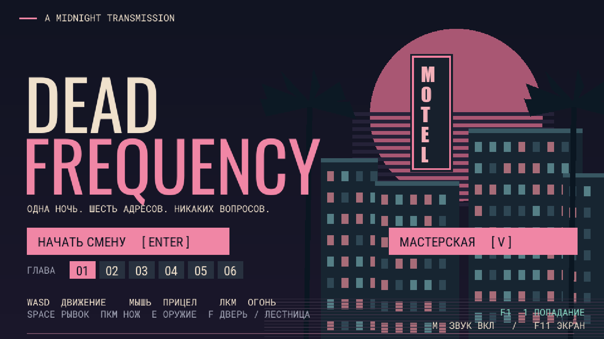
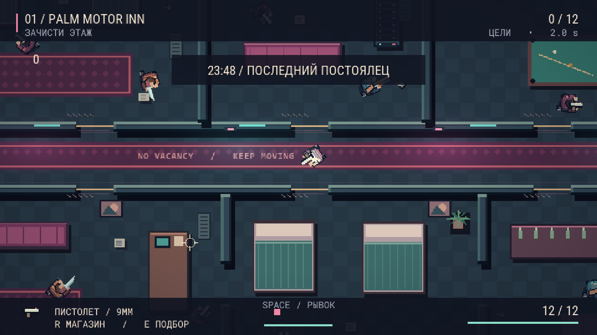
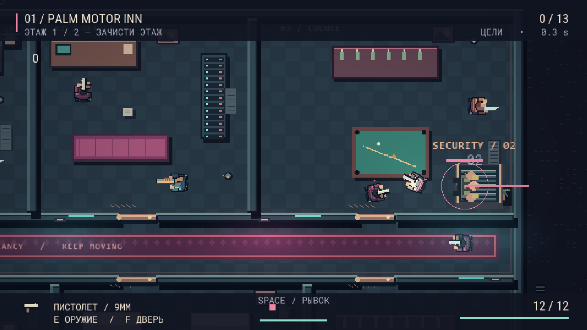
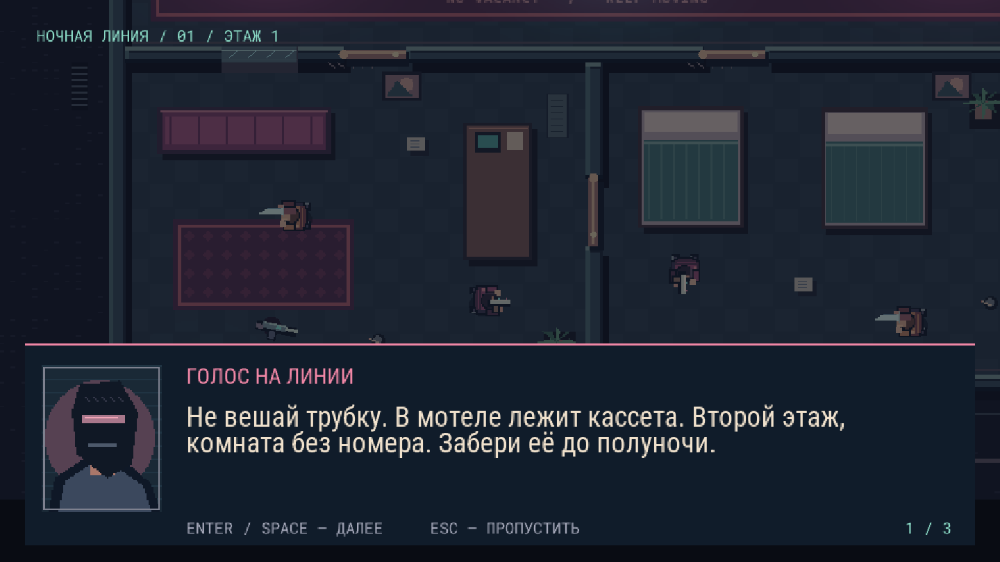
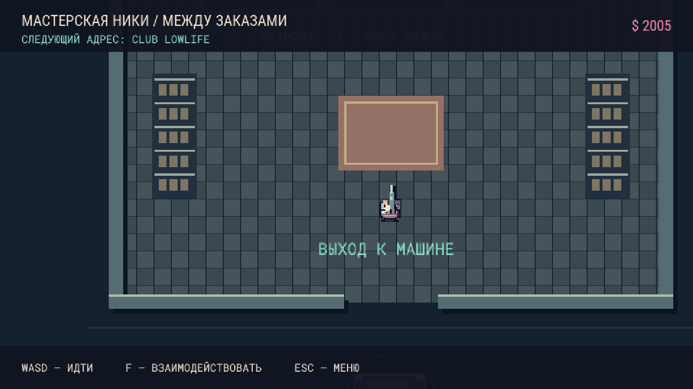

# 🩸 DEAD FREQUENCY

<p align="center">
  
</p>

<p align="center">
  <b>Ураганный неоновый top-down экшен в стилистике Hotline Miami на движке GameMaker LTS 2026.</b><br/>
  <i>Ночная смена, звонки из таксофона, динамические двери, 160 BPM синтвейва и 164 вооружённых головореза.</i>
</p>

<p align="center">
  <a href="https://github.com/faoick/DeadFrequency/releases"></a>
  
  
  
  
</p>

---

## 📸 Скриншоты и геймплей

<p align="center">
  
  
</p>
<p align="center">
  
  
</p>

---

## 📖 О проекте

**Dead Frequency** — полностью оригинальная нативная Windows 2D-игра, созданная на **GameMaker LTS 2026**. Вдохновлена бешеной динамикой *Hotline Miami*, но построена на собственной вселенной, авторских механиках, оригинальном пиксель-арте и процедурно синтезированном саундтреке.

Город тонет в неоновом дыме и битом стекле. Вы получаете контракт, подъезжаете к объекту на классическом маслкаре, выбиваете двери с ноги и зачищаете этаж за этажом под пульсирующий 160 BPM синтвейв.

### 🎮 Ключевые особенности версии 4.0:
- 🏢 **6 масштабных контрактов (12 этажей, 164 противника)**:
  - `Глава 1: Ночной мотель` — узкие коридоры, засады в номерах.
  - `Глава 2: Неоновый клуб` — плотный огонь сквозь танцпол и VIP-ложи.
  - `Глава 3: Радиовещательная станция` — кабельные тоннели, аппаратные и студии.
  - `Глава 4: Портовый склад` — контейнерные лабиринты и открытые ангары.
  - `Глава 5: Ночная прачечная` — ряды стиральных машин, тактическое использование укрытий.
  - `Глава 6: Пентхаус` — финальная цитадель на крыше небоскрёба.
- 🚪 **Физические створки дверей**: двери реалистично вращаются на петлях, сохраняя габариты. Удар с ноги или рывок распахивает дверь и **оглушает стоящего за ней врага**, открывая окно для добивания.
- 🪟 **Разрушаемые стекла**: окна и стеклянные перегородки прозрачны для обзора, но блокируют движение. Выстрел, нож или рывок разбивают стекло вдребезги с персистентными осколками, создавая неожиданный штурмовой коридор.
- 👹 **Тяжёлые охранники (Энфорсеры)**: каждый первый этаж охраняет мини-босс с запасом в 8–13 HP. Их рывок телеграфируется красным следом; при захвате запускается интенсивное QTE (чередование клавиш `A` и `D`).
- 🚗 **Мастерская Ники и экономика контрактов**: за выполнение заказов начисляется награда (\$300–\$1075). В гараже-мастерской можно приобретать пистолеты-пулемёты, дробовики и кевларовую броню перед выездом на следующий рейс.
- 🩸 **Кинематографичная физика боя**: брызги и растекающиеся лужи крови, скользящие трупы, вылетающие гильзы, дульные вспышки, шлейфы рывка и микро-стоп кадр (hitstop) при попадании.
- 📼 **Сюжет «Ночная линия»**: глубокая детективная история на русском языке с анимированными портретами персонажей (`story.json`).

---

## 🕹️ Управление

| Действие | Клавиша / Ввод | Примечание |
|---|---|---|
| **Перемещение** | `W` `A` `S` `D` / Стрелки | Скорость 4.05 px/кадр |
| **Прицеливание** | `Мышь` | Точный сектор наведения |
| **Огонь** | `ЛКМ` (зажатие) | Автоматический темп для каждого оружия |
| **Удар ножом** | `ПКМ` | Быстрый бесшумный взмах перед собой |
| **Тактический рывок** | `Space` + направление | Кратковременная неуязвимость для уклонения |
| **Выбить дверь** | `ПКМ` / `Space` у двери | Распахивает створку и оглушает врага |
| **Поднять оружие** | `E` | Подбор ствола с пола |
| **Действие / Взаимодействие** | `F` | Открыть дверь, сесть в машину, подняться по лестнице |
| **Диалог** | `Enter` / `Space` / `ЛКМ` | Ускорить текст / продолжить |
| **Пропуск диалога** | `Esc` | Моментальный переход к действию |
| **Рестарт после смерти** | `R` | Мгновенный перезапуск с контрольной точки |
| **Освобождение от захвата** | Попеременно `A` ↔ `D` | Быстрое QTE против Энфорсера |
| **Режим помощи (Assist)** | `F1` | 2 HP вместо одного, враги дольше прицеливаются |
| **Настройки экрана / FX** | `F2` (Camera Shake) / `F3` (Blood) / `F11` (Full Screen) | Переключение визуальных эффектов |

---

## 🔫 Арсенал

```
[ PISTOL ]      Точный полуавтоматический огонь, стандартный магазин, средняя дальность.
[ SMG ]         Бешеный темп стрельбы, разброс в коридорах, магазин высокой емкости.
[ SHOTGUN ]     8 картечин веером, смертоносная зачистка комнат на ближней дистанции.
[ COMBAT KNIFE] Тихий летальный клинок, идеален для добивания оглушённых дверью целей.
```

---

## 🚀 Как запустить игру

### Вариант 1: Готовая сборка (без установки GameMaker)
1. Скачайте архив **`DeadFrequency-Windows.zip`** из [Releases](https://github.com/faoick/DeadFrequency/releases) (или используйте папку `Windows-v4/`).
2. Распакуйте архив в любую папку.
3. Запустите **`DeadFrequency.exe`** и нажмите `Enter` в меню.

### Вариант 2: Открыть исходный проект в GameMaker
1. Клонируйте репозиторий:
   ```bash
   git clone https://github.com/faoick/DeadFrequency.git
   ```
2. Откройте файл `DeadFrequency.yyp` в **GameMaker LTS 2026** (runtime 2026.0.0.23+).
3. Нажмите `F5` для запуска игры.

---

## 🛠️ Архитектура и структура проекта

```
DeadFrequency/
├── DeadFrequency.yyp          # Манифест проекта GameMaker LTS 2026
├── scripts/
│   ├── scr_game/              # Боевой движок, ИИ врагов, частицы крови, HUD
│   ├── scr_campaign/          # Лестницы, главы, контрольные точки и диалоги
│   ├── scr_action/            # Патрулирование, физика дверей, стекла, мини-боссы
│   ├── scr_hub/               # Экономика, магазин Ники, маслкар, выезды
│   └── scr_tests/             # Автоматизированный тестовый фреймворк
├── datafiles/
│   ├── levels.json            # Координаты стен, комнат и точек спавна врагов
│   └── story.json             # Тексты реплик и сценарий на русском языке
├── tools/                     # Python-пайплайн воспроизводимой генерации
│   ├── make_assets.py         # Процедурная генерация пиксель-арта и аудио
│   ├── make_campaign.py       # Генерация верхних этажей и портретов
│   ├── make_expansion.py      # Генерация планировок и оружия
│   └── make_v4.py             # Сборка механик v4 (двери, мастерская, энфорсеры)
├── screenshots/               # Актуальные игровые скриншоты
├── licenses/                  # Лицензии используемых шрифтов и CC0-аудио
└── Windows-v4/                # Нативный исполняемый билд Windows
```

---

## 🧪 Автотесты (Smoke Testing)

В проект встроен автономный стресс-тест движка:

```powershell
.\Windows-v4\DeadFrequency.exe --smoke-test
```

Тест последовательно симулирует:
- Проверку навигационной сетки для всех 164 противников;
- Реакции коллизий при выбивании дверей и разбитии стеклянных перегородок;
- Корректность переноса боезапаса и сохранения контрольных точек;
- QTE-механику захватов и расчет урона.

---

## 📜 Лицензии и копирайт

- **Код и логика**: Создано для проекта *Dead Frequency*.
- **Графика и Музыка**: Полностью оригинальные авторские ассеты, процедурно сгенерированные без заимствования ресурсов сторонних игр.
- **Шрифты**: Oswald, Roboto Condensed, Roboto Mono ([SIL Open Font License](licenses/Oswald-OFL.txt)).
- **Звуковые эффекты**: Использованы свободные сэмплы под лицензией [Creative Commons CC0](licenses/Audio-CC0.txt).

---

<p align="center">
  <b>Developed by faoick • 2026</b>
</p>
